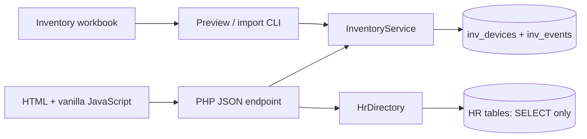

# Implementation map

Both table groups live in `attendance_monitoring`. PHP reads `config.local.php` outside the public web root. No database credentials reach the browser. There are no framework, package-manager, or build dependencies. Class loading is handled by `app/bootstrap.php`.

`InventoryService` owns device validation, persistence, assignments, notes, and import. Every mutation and its event use one transaction. Device edits and holder changes require the current integer version; conflicts return 409. Text SQL values use prepared parameters. Device IDs are internal primary keys because the workbook has missing and repeated serial/tag values.

`HrDirectory` is the only adapter to the timekeeping schema. Its fixed SELECT reads `employees`, `departments`, `branches`, and `branch_employee`. Numeric `employees.id` identifies an assignment; `employee_id` is the visible employee number. `position` is the job title and `role` is the HR access role. Branch selection uses the primary pivot row, then the first pivot row, then the legacy `employees.branch` field. Names match the existing HR model's first-name plus last-name display. Passwords, birthdays, attendance, and biometrics are excluded.

`Workbook` reads the bundled XLSX through ZipArchive and SimpleXML for optional initial seeding. It verifies the expected sheet headers, reads keyboard/mouse serials and asset tags from separate columns, separates any combined monitor identifiers, splits PC rows into components, and retains raw row cells. The import is append-only with stable original sheet/row/component keys. Reruns skip existing keys; they do not overwrite corrections. Unknown condition, location, date, or employee ID is never inferred.

After seeding, the website and inventory database are the source of current device details, assignments, and history. The application runs without the workbook; new devices are registered through the website. Workbook source JSON remains an original import snapshot after edits. Excel is not an ongoing update mechanism or a destination for website changes.

Workbook holders (`holder_kind: imported`) are accepted as assigned to the recorded names. They display as Assigned and are included in assigned counts and filters without requiring an HR employee ID. HR equipment counts use explicit numeric links; no fuzzy name matching is performed. Future assignment changes use the website's HR selector.

HR's `departments` table owns the department directory. `HrDirectory::departments()` returns its complete ID/name projection; dropdowns do not merge workbook labels or derive departments from the employee list. Inventory stores `department_id` plus a canonical `department` snapshot, with no cascading HR foreign key. Shared assignment validates the department ID; employee assignment takes the employee's HR department ID. API display resolves stored IDs or unique formatting variants to current HR names while retaining snapshots for deleted departments. Explicit aliases handle confirmed abbreviations; ambiguous or unknown names are rejected on import or reconciliation.

`WorkbookDepartmentCleanup` changes only column B department cells, preserves cell styles and all other values, verifies the new workbook before replacement, and backs up the original. `tools/clean-departments.php` reads live HR by default; an explicit `--hr-list` can use a user-supplied HR snapshot for offline Excel cleanup. `--apply --reconcile-inventory` also canonicalizes existing inventory labels/IDs against live HR in one transaction with new history events, preserving original source JSON and earlier events. Repeat cleanup skips unchanged records. `data/department-aliases.json` contains the confirmed label mappings; `data/hr-departments.reference.json` is the user-provided offline reference, not the runtime department directory.

When a later cleanup changes the workbook again, prior backups remain intact. The writer selects the next numbered backup, reusing an existing backup only when its content matches the current workbook. A differing original backup never blocks a later HR spelling correction.

Device location is separate from the holder's organizational branch. `location_branch_id` stores a numeric HR branch ID without a cascading foreign key; `location` keeps the last saved branch name as a snapshot. The website selects locations from `HrDirectory::branches()` and resolves current names for display, retaining the snapshot if HR removes a branch. Setup adds the column to older inventory tables. Import with `--location-apo` resolves APO's ID through the directory; it fills only blank existing locations and records each change and snapshot atomically.

`inv_devices.handover_date` stores the current handover date separately from dated history events. Setup adds this nullable column to existing inventory tables. Assignment saves the provided date; return clears the current date. `tools/set-equipment-baseline.php --date=YYYY-MM-DD --apply` explicitly sets all current devices to Good with that handover date in one transaction, recording a before/after baseline event per changed device and preserving old history. A repeat skips devices already matching the condition/date; it does not change holders or IDs or apply automatically to future devices.

The browser loads the full initial dataset because the workbook contains only 216 items. It filters locally and joins current HR details for display. It never writes employee data. Per-device history is requested separately; the activity view shows the latest 100 events. Rendered dynamic strings are escaped. Keep more complex pagination, caching, and framework code for a measured need.

## Endpoint contract

All routes use `public/api.php?action=...`, return JSON, and accept same-origin requests. Success is `{ "data": ... }`; failure is `{ "error": "message" }` with the appropriate HTTP status. GET responses and the page are uncached. POST requires `Content-Type: application/json` and `X-CSRF-Token` from the page's meta tag.

| Action | Method | Input | Result |
|---|---|---|---|
| `state` | GET | None | `devices`, projected `employees`, HR `departments` and `branches` (ID/name), latest `activity` |
| `history` | GET | Positive `id` in query string | Full device event list, newest first |
| `device` | POST | Type, name, condition; optional serial, tag, location branch ID, specifications; `id` and `version` for edit | Saved device |
| `assignment` | POST | `id`, `version`, holder kind; employee ID or shared `department_id`; optional handover date/notes | Saved device |
| `note` | POST | `id`, nonempty `message` up to 2,000 characters | `saved: true` |

The editable device wire fields are `device_type`, `name`, `device_condition`, `serial_number`, `asset_tag`, `location_branch_id`, and `specifications` (a name/value map). Location IDs are validated against HR branches; blank/null clears the location. Legacy text `location` input is still accepted and clears its branch link. Omitting both location fields on edit preserves the current location. Accepted types/conditions are declared in `InventoryService`. Holder kinds accepted by assignment are `employee`, `shared`, and `unassigned`; `imported` is reserved for workbook imports. The employee input is `hr_employee_id`. Handover dates are optional real `YYYY-MM-DD` dates, distinct from server-recorded timestamps.

Validation errors return 422, missing devices 404, stale versions 409, forbidden requests 403, wrong methods 405, and database/setup failures 503. Technical errors go to PHP's error log; API responses omit database details. There is no delete operation: returning equipment preserves device identity and handover history.

Shared assignment uses numeric `department_id`. Legacy `department` text input is accepted only if it resolves uniquely to the HR directory using confirmed aliases; it never creates a department. Employee rows also expose their HR `department_id`. Setup adds the nullable inventory department ID column to older tables.

## Later work

Workbook holder names remain assigned snapshots until staff change them through the regular assignment flow. No employee ID is inferred from a name. That flow validates the selected numeric HR ID and records changes atomically; HR remains read-only.

`Auth` authenticates against `attendance_monitoring.users` through authentication-only SELECT projections in `HrDirectory`. Users sign in with their attendance username or email and existing password, verified using PHP `password_verify`; only `is_admin` or `is_it_admin` users are allowed. They receive inventory editor access. Other users cannot access the page or API. `employees.role` remains directory display data. User creation, password changes, and admin flags are managed in attendance; inventory never updates HR users or their password hashes. Neither hashes nor credential projections reach directory/API responses.

`Http` retains the default local gate and CSRF/session security; `Auth` protects the page and every API action. Anonymous or revoked sessions receive 401 before inventory access. Sessions bind to numeric `users.id` and a password-hash fingerprint; each request rechecks the user's password hash and admin flags. Password changes, deletion, or removal of both admin flags revoke access immediately. Login/logout rotate session IDs and CSRF tokens. Idle and absolute lifetimes are 30 minutes/eight hours. Login failure windows are shared across workers using a locked file, keyed by numeric user ID and direct client IP, so username/email aliases cannot bypass the account limit. Unknown identities use a hashed login string. Forwarded headers are not trusted. The optional throttle directory on login is for isolated tests. Attendance and inventory sessions are separate; this reuses credentials rather than sharing Laravel cookies.

`tools/host-lan.ps1` checks existing attendance Admin/IT Admin availability, activates LAN in local config, installs the dedicated Apache port 8081 virtual host, and limits the Windows Firewall rule to Private/local subnet. It performs no account creation or password prompts. Apache serves only `public/` and accepts private IPv4/loopback addresses. Keep the original local virtual host when LAN is not enabled. Apache must be reloaded through Laragon after installation. Legacy inventory account files are ignored; `tools/user.php` was removed.

Use a database account with SELECT on the four HR directory tables plus `users`, and CRUD on the inventory tables; use a separate privileged account for setup/testing. Add formal issue state or group operations only when their behavior is agreed. The existing tests provide a small regression baseline.
