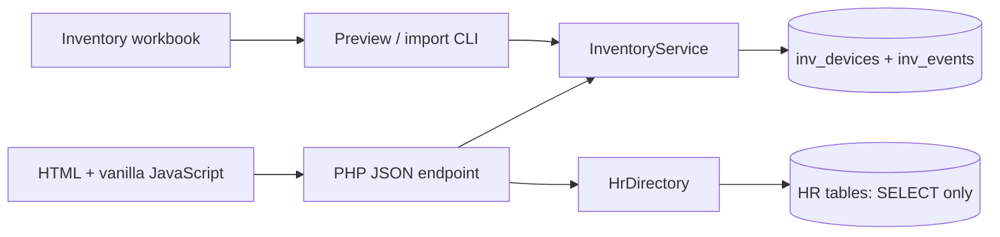

# Implementation map

Preset's top-right **Create Device Type** action opens a name-only dialog. Authenticated editor `POST preset` accepts `version` and `name` to append a trimmed, unique (case-insensitive) type of 1–30 characters. Names use the existing `VARCHAR(30)` inventory column. The same locked/versioned preset file retains `device_types` and a `presets` map keyed by device type alongside the legacy Desktop `fields`; older files default to built-in types. Saving Desktop fields preserves types and adding a type preserves Desktop fields. API state exposes types inside `desktop_preset`; creation, editing, filters, and inventory validation use these choices, including workbook updates and CLI validation. Other new device types start with empty presets that can be edited independently; existing edits always use their recorded specifications. No inventory records are changed by preset/type saves and no migration is required.

Desktop creation presets live in `storage/desktop-preset.json`, outside public/, with ordered name/value fields and an integer version. `DevicePreset` validates fields and saves under a file lock with atomic replacement; stale saves return 409. `state` includes `desktop_preset`; authenticated editor `POST preset` accepts `version`, `device_type` (defaults to Desktop for legacy callers), and `fields` (up to 128 name/value objects). The Preset tab initially asks for a device type in a dropdown and supports dragging and keyboard arrow buttons. The generic Other type has no preset and is omitted from the Preset dropdown. Preset rows expose specification names only, preserving any previously saved default values. Add device specification values use Yes/No/Other selectors; Other reveals a text input and blank values remain unset. Existing-device edits retain their text editors. Each new device form uses its type's saved defaults. The device API also supplies those defaults for creation requests that omit `specifications`; an explicit map (including an empty map or cleared values) takes precedence. Defaults and the creation history snapshot are saved together; existing devices and import/export behavior are unchanged. No database migration is needed. Back up the preset file with inventory storage.

Associates belong to the fixed inventory-only branch `Other`, exposed by the associate directory and recorded in assignment snapshots. The branch filter includes Other without creating an HR branch or using a synthetic HR branch ID. Existing associate equipment resolves to Other for display/export.

Inventory also owns `inv_associates` (ID, name, optional job title) for inventory-only contacts. `POST associate` creates these records; `GET state` exposes them separately as `associates`. Assignment accepts `holder_kind: associate` with a positive `associate_id`, clears the HR link, and records the holder snapshot atomically with device history. Returns/reassignment clear the associate link. People combines the directories for display; negative UI filter keys identify associates while stored associate and HR IDs remain separate positive integers. Added users are not attendance employees or login accounts. Excel exports include an optional Associate ID column; older exports remain readable and associate imports never infer HR links by name.

Both table groups live in `attendance_monitoring`. PHP reads `config.local.php` outside the public web root. No database credentials reach the browser. There are no framework, package-manager, or build dependencies. Class loading is handled by `app/bootstrap.php`.

`InventoryService` owns device validation, persistence, assignments, notes, and import. Every mutation and its event use one transaction. Device edits and holder changes require the current integer version; conflicts return 409. Text SQL values use prepared parameters. Device IDs are internal primary keys because the workbook has missing and repeated serial/tag values.

`HrDirectory` is the only adapter to the timekeeping schema. Its fixed SELECT reads `employees`, `departments`, `branches`, and `branch_employee`. Numeric `employees.id` identifies an assignment; `employee_id` is the visible employee number. `position` is the job title and `role` is the HR access role. Branch selection uses the primary pivot row, then the first pivot row, then the legacy `employees.branch` field. Names match the existing HR model's first-name plus last-name display. Passwords, birthdays, attendance, and biometrics are excluded.

`Workbook` reads XLSX through ZipArchive and SimpleXML. It verifies original sheet headers, maps component identifiers, splits PC rows, retains raw row cells, and includes all additional specification columns. Software belongs to desktops/laptops; duplicate and unnamed headers retain column identity. CLI seeding stays append-only with stable sheet/row/component keys and skips existing keys. Website imports use the reviewed update flow below.

The website and inventory database hold current device details, assignments, and history. The application runs without the bundled workbook. Excel updates and downloads are explicit user actions, never automatic synchronization. Original source JSON remains intact after updates.

Workbook holders (`holder_kind: imported`) are accepted as assigned to recorded names, included in assigned counts/filters without an HR ID. HR equipment counts use numeric links. Website import suggests unique case/whitespace-normalized name matches or valid existing links; all suggestions are editable and require grouped approval. There is no fuzzy matching or HR mutation. Blank selections retain holder snapshots.

`ImportPreview` prepares groups against current inventory and HR. It detects conflicting links and repeated targets, captures versions, and issues a random session-bound token with a 30-minute expiry. Changing HR selections merges groups in the browser; approval submits original group IDs plus the chosen numeric employee IDs. One active preview is kept server-side, and successful approval releases it. Parsed rows never come back from the browser as mutation payloads.

PC component fields are resolved by case/whitespace-normalized header names instead of fixed physical columns. The reader accepts separate accessory serial/tag headers or combined `SERIAL NO#/ASSET TAG` headers; combined cells use the existing identifier splitter. Missing, ambiguous, or mixed identifier headers are rejected. Actual mapped columns are excluded from additional specifications, so shifted OS/MAC/software fields retain their meaning. Component source keys remain stable and source cells retain their original column positions.

`InventoryService::applyImport` owns the grouped transaction: replace imported device information/specifications, update assignments, and write an event per device. Original-format updates preserve condition/location/handover date. Source JSON and device IDs remain intact; import-update events include incoming rows and before/after snapshots. Existing versions are checked, and new original source keys are checked again before insert. A stale/conflicting device or failed history insert rolls back every selected group. Devices absent from the selected rows are untouched. Identifiers/names never determine device identity.

`WorkbookExchange` writes a string-only XLSX with a Devices sheet, one row per device, stable Inventory ID/Source key columns, assignment/location/date fields, and the union of current specifications prefixed `Spec: `. Explicit IDs must exist and agree with source keys on reimport; new rows clear both metadata fields. Export resolves current HR holder details while retaining deleted employee snapshots. Formula-like strings remain literal, and leading zeros/multiline values survive roundtrips. Temporary exports live outside public/ in storage/ and are deleted after streaming. No schema changes or third-party dependencies are required.

HR's `departments` table owns the department directory. `HrDirectory::departments()` returns its complete ID/name projection; dropdowns do not merge workbook labels or derive departments from the employee list. Inventory stores `department_id` plus a canonical `department` snapshot, with no cascading HR foreign key. Shared assignment validates the department ID; employee assignment takes the employee's HR department ID. API display resolves stored IDs or unique formatting variants to current HR names while retaining snapshots for deleted departments. Explicit aliases handle confirmed abbreviations; ambiguous or unknown names are rejected on import or reconciliation.

`WorkbookDepartmentCleanup` changes only column B department cells, preserves cell styles and all other values, verifies the new workbook before replacement, and backs up the original. `tools/clean-departments.php` reads live HR by default; an explicit `--hr-list` can use a user-supplied HR snapshot for offline Excel cleanup. `--apply --reconcile-inventory` also canonicalizes existing inventory labels/IDs against live HR in one transaction with new history events, preserving original source JSON and earlier events. Repeat cleanup skips unchanged records. `data/department-aliases.json` contains the confirmed label mappings; `data/hr-departments.reference.json` is the user-provided offline reference, not the runtime department directory.

When a later cleanup changes the workbook again, prior backups remain intact. The writer selects the next numbered backup, reusing an existing backup only when its content matches the current workbook. A differing original backup never blocks a later HR spelling correction.

Device location is separate from the holder's organizational branch. `location_branch_id` stores a numeric HR branch ID without a cascading foreign key; `location` keeps the last saved branch name as a snapshot. The website selects locations from `HrDirectory::branches()` and resolves current names for display, retaining the snapshot if HR removes a branch. Setup adds the column to older inventory tables. Import with `--location-apo` resolves APO's ID through the directory; it fills only blank existing locations and records each change and snapshot atomically.

`inv_devices.handover_date` stores the current handover date separately from dated history events. Setup adds this nullable column to existing inventory tables. Assignment saves the provided date; return clears the current date. `tools/set-equipment-baseline.php --date=YYYY-MM-DD --apply` explicitly sets all current devices to Good with that handover date in one transaction, recording a before/after baseline event per changed device and preserving old history. A repeat skips devices already matching the condition/date; it does not change holders or IDs or apply automatically to future devices.

The browser loads the full initial dataset because the workbook contains only 216 items. It filters locally and joins current HR details for display. It never writes employee data. Per-device history is requested separately; the activity view searches all recorded events, newest first, and renders 50 initially. An IntersectionObserver in the table scroll container appends the next 50 near the bottom; Load more changes also supports keyboard access and browsers without the observer. Search, refresh, and navigation reset the visible batch. Rendered dynamic strings are escaped. Keep more complex pagination, caching, and framework code for a measured need.

Browser evidence preparation accepts up to five JPEG/PNG/WebP originals of 20 MiB and 40 megapixels each. Small images (at most 2 MiB and 2,000 pixels on the longest edge) pass through. Larger images are resized proportionally to at most 2,000 pixels and encoded as JPEG at 85% quality, with lower quality retries down to 55% to meet the existing 2 MiB server limit. Transparent backgrounds become white. Preparation is sequential and completes before the save request; failures leave the form available for retry. PHP multipart request limits still apply to the combined prepared files.

Photo compression smoke checks: create and edit equipment using a phone photo above 2 MiB; check progress, orientation, proportions, serial-number readability and saved history photos. Try five photos, a small unchanged image, transparent PNG, a corrupt image, an unsupported format, and an original above 20 MiB. Confirm errors leave the form retryable without saving. Check mobile, keyboard and Escape behavior during preparation. Ensure PHP `post_max_size` accommodates five prepared photos plus form data (at least 12 MiB recommended).

## Endpoint contract

`state` devices include nullable `photo_event_id` and `photo_index`, identifying the first remaining uploaded image. One inventory query projects only photo metadata/removal references. `evidence&event=ID&photo=INDEX&thumbnail=1` serves a cached 96×96 JPEG derivative after authentication. Derivatives use GD and live beside originals outside public/. Private browser caches revalidate; 304 is sent only after authentication. IntersectionObserver with an 80px margin and lazy-image fallback defers portraits until they approach view.

`POST photo-remove` accepts `id`, `version`, `event`, and zero-based `photo`. It removes exactly one photo from the current gallery by appending a `photo-remove` event with an immutable `removed_photo` reference, authenticated actor, and before/after device snapshots. Device version increment and removal history are atomic. No files or prior events are deleted; authenticated evidence URLs keep working. History exposes `removed_photo_indexes` on original upload events for gallery filtering/history labels. Invalid, cross-device, duplicate, or stale removals are rejected; no migration is required.

Device events include an `actor` identity snapshot (`id`, `name`, `username`) in the existing event JSON, saved atomically with each change. API constructs InventoryService with the authenticated attendance user; request data cannot set audit identity. Each device History entry displays Recorded by with the saved actor name and username, falling back to the username or Not recorded for legacy events. History/activity expose only this identity projection, with `actor: null` for historical events without attribution. New CLI events use System / CLI. Names remain as recorded after account renaming/deletion. No migration or HR writes are needed.

Device creation/editing accepts JSON as before or multipart data with a JSON `device` field and optional `photos[]`. Up to five JPEG/PNG/WebP images (2 MiB each, 40 megapixels) are validated by content. Files live outside the document root in `storage/evidence/`; metadata is attached to the create/edit event's existing snapshot JSON in the device transaction. Failed saves remove uploaded files. History exposes `photos` without exposing complete snapshots. Authenticated `GET evidence&event=ID&photo=INDEX` streams an event's photo through the existing access gate. No migration is needed. Back up the evidence directory together with inventory tables.

All routes use `public/api.php?action=...` and accept same-origin requests. Success is `{ "data": ... }`; failure is `{ "error": "message" }` with the appropriate HTTP status. Export returns XLSX on success. GET responses and the page are uncached. POST requires JSON and `X-CSRF-Token`, except import-preview and device photo uploads which use multipart form data with the same CSRF header. JSON requests are capped at 1 MiB to support larger specification edits.

| Action | Method | Input | Result |
|---|---|---|---|
| `state` | GET | None | `devices`, projected `employees`, HR `departments` and `branches` (ID/name), complete `activity` |
| `history` | GET | Positive `id` in query string | Full device event list, newest first |
| `device` | POST | Type, name, condition; optional serial, tag, location branch ID, specifications; `id` and `version` for edit | Saved device |
| `assignment` | POST | `id`, `version`, holder kind; employee ID or shared `department_id`; optional handover date/notes | Saved device |
| `note` | POST | `id`, nonempty `message` up to 2,000 characters | `saved: true` |
| `import-preview` | POST | Multipart `workbook` XLSX, up to 5 MiB | Token, expiry, groups with incoming devices/current snapshots, projected employees |
| `import-apply` | POST | `token`, `groups`: each has `id`, `hr_employee_id` (nullable), and `resolved` for conflicts | `added`, `updated`; one atomic approval |
| `export` | GET | None | XLSX download of all current devices |

Workbook ZIPs allow up to 256 entries and 32 MiB expanded contents; previews allow 2,000 devices. Missing/malformed original or export headers and invalid workbooks return validation errors. Specifications support 128 populated fields, names up to 100 characters, and values up to 4,000 characters. Excess data is rejected instead of truncated. Expired previews and stale devices return 409.

The editable device wire fields are `device_type`, `name`, `device_condition`, `serial_number`, `asset_tag`, `location_branch_id`, and `specifications` (a name/value map). Location IDs are validated against HR branches; blank/null clears the location. Legacy text `location` input is still accepted and clears its branch link. Omitting both location fields on edit preserves the current location. Accepted types/conditions are declared in `InventoryService`. Holder kinds accepted by assignment are `employee`, `shared`, and `unassigned`; `imported` is reserved for workbook imports. The employee input is `hr_employee_id`. Handover dates are optional real `YYYY-MM-DD` dates, distinct from server-recorded timestamps.

Validation errors return 422, missing devices 404, stale versions 409, forbidden requests 403, wrong methods 405, and database/setup failures 503. Technical errors go to PHP's error log; API responses omit database details. There is no delete operation: returning equipment preserves device identity and handover history.

Shared assignment uses numeric `department_id`. Legacy `department` text input is accepted only if it resolves uniquely to the HR directory using confirmed aliases; it never creates a department. Employee rows also expose their HR `department_id`. Setup adds the nullable inventory department ID column to older tables.

## Later work

Workbook holder names remain snapshots until staff link/reassign them through regular assignment or approve an Excel group with an HR selection. Both flows validate numeric HR IDs and record changes atomically; HR remains read-only.

`Auth` authenticates against `attendance_monitoring.users` through authentication-only SELECT projections in `HrDirectory`. Users sign in with their attendance username or email and existing password, verified using PHP `password_verify`; only `is_admin` or `is_it_admin` users are allowed. They receive inventory editor access. Other users cannot access the page or API. `employees.role` remains directory display data. User creation, password changes, and admin flags are managed in attendance; inventory never updates HR users or their password hashes. Neither hashes nor credential projections reach directory/API responses.

`Http` retains the default local gate and CSRF/session security; `Auth` protects the page and every API action. Anonymous or revoked sessions receive 401 before inventory access. Sessions bind to numeric `users.id` and a password-hash fingerprint; each request rechecks the user's password hash and admin flags. Password changes, deletion, or removal of both admin flags revoke access immediately. Login/logout rotate session IDs and CSRF tokens. Idle and absolute lifetimes are 30 minutes/eight hours. Login failure windows are shared across workers using a locked file, keyed by numeric user ID and direct client IP, so username/email aliases cannot bypass the account limit. Unknown identities use a hashed login string. Forwarded headers are not trusted. The optional throttle directory on login is for isolated tests. Attendance and inventory sessions are separate; this reuses credentials rather than sharing Laravel cookies.

`tools/host-lan.ps1` checks existing attendance Admin/IT Admin availability, activates LAN in local config, installs the dedicated Apache port 8081 virtual host, and limits the Windows Firewall rule to Private/local subnet. It performs no account creation or password prompts. Apache serves only `public/` and accepts private IPv4/loopback addresses. Keep the original local virtual host when LAN is not enabled. Apache must be reloaded through Laragon after installation. Legacy inventory account files are ignored; `tools/user.php` was removed.

Use a database account with SELECT on the four HR directory tables plus `users`, and CRUD on the inventory tables; use a separate privileged account for setup/testing. Add formal issue state or group operations only when their behavior is agreed. The existing tests provide a small regression baseline.
